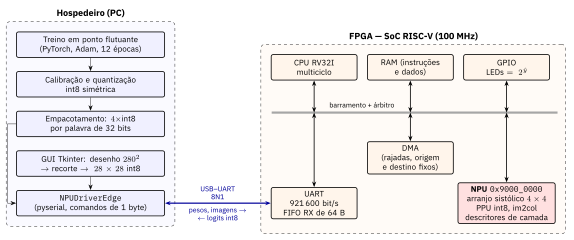

# Servidores da NPU

Os servidores são programas do SoC que atendem um cliente no computador hospedeiro: recebem modelos e dados pela UART, executam o cálculo na [NPU](../perifericos/npu.md) e devolvem os resultados. A divisão de trabalho é sempre a mesma: **o hospedeiro treina e quantiza; o SoC só executa a inferência**.

<figure class="ax-figura" markdown>
  { width="760" }
  <figcaption>A aplicação da CNN: no hospedeiro, o cliente treina, quantiza e empacota os pesos e oferece a interface de desenho; pela UART, o SoC recebe o modelo uma vez e as imagens a cada inferência, executa a rede na NPU e devolve os <em>logits</em>.</figcaption>
</figure>

| Servidor | Cliente | Função |
|---|---|---|
| `cnn_server.c` | `tools/cnn_client.py` | Inferência de uma CNN para o MNIST, com interface de desenho |
| `cnn_server_bluetooth.c` | `tools/cnn_client.py` (porta do Bluetooth) | O mesmo servidor, pela UART2 e uma ponte Bluetooth |
| `bench_server.c` | `tools/bench_client.py`, `tools/bench_v2.py` | *Benchmark* da NPU contra a CPU |

## Servidor da CNN (`cnn_server.c`)

O servidor executa uma rede convolucional para dígitos manuscritos: uma convolução $3\times3$ com passo 2 e 4 filtros, seguida de ReLU e de uma camada densa $676\to10$. A rede inteira roda na NPU, com os mecanismos de movimentação de dados ligados: pesos e vieses residentes, *im2col* em hardware, modo GEMV na camada densa, fusão das duas camadas e um programa de descritores que configura a NPU sem a CPU.

### Protocolo

O cliente envia um byte de comando seguido dos dados, e o servidor responde com uma letra de confirmação ou com os resultados. Os inteiros de 32 bits trafegam em ordem *big-endian*.

| Comando | Dados (hospedeiro → SoC) | Resposta |
|:---:|---|:---:|
| `0xAA` | 9 palavras: filtros da convolução empacotados (4 filtros por palavra) | `'A'` |
| `0xBB` | 4 × int32: vieses da convolução | `'B'` |
| `0xCC` | 2.028 palavras: pesos da camada densa empacotados (3 blocos de 4 neurônios × 676) | `'C'` |
| `0xDD` | 12 × int32: vieses da camada densa (os dois últimos são zero) | `'D'` |
| `0xFF` | 784 bytes: imagem $28\times28$, linha a linha, com pixels de 0 a 127 | 10 × int8: *logits* |

A carga do modelo (`0xAA` a `0xDD`) acontece uma única vez; os pesos ficam residentes nas memórias da NPU. A cada imagem (`0xFF`), a CPU envia por DMA o programa de descritores e a imagem crua, lê os 10 *logits*, acende o LED do dígito previsto e o mostra no *display*.

### Desempenho

A NPU executa a rede inteira em cerca de 1.500 ciclos (15 µs a 100 MHz). Uma inferência pelo cliente, do envio da imagem à chegada dos *logits*, leva cerca de 9 ms, quase todos gastos na transmissão serial: o cálculo é menos de 0,2% do tempo. A análise completa, com o treino, a quantização e as medições na placa, está no [estudo de caso da documentação da NPU](https://risc-v-azedinha.github.io/NPU/avaliacao/cnn-mnist/).

### Cliente (`tools/cnn_client.py`)

O cliente treina a rede com PyTorch, quantiza os pesos para INT8, envia o modelo e abre uma janela em que o usuário desenha um dígito com o mouse. A cada traço, o desenho é recortado, reduzido a $28\times28$ e enviado ao SoC, e a janela mostra o dígito previsto e a latência.

```bash
make upload SW=cnn_server
python3 tools/cnn_client.py          # porta configurada em SERIAL_PORT, no início do arquivo
```

## Servidor por Bluetooth (`cnn_server_bluetooth.c`)

O mesmo servidor, com o mesmo protocolo, atendendo pela [UART2 no Pmod JA](../perifericos/uart.md#uart2-no-pmod-ja). Um ESP32 ligado ao Pmod faz a ponte entre a UART2 e o Bluetooth clássico (SPP), e o cliente só troca a porta serial pela do Bluetooth. A UART do USB fica livre para depuração: o servidor escreve nela o dígito de cada inferência.

## Servidor de *benchmark* (`bench_server.c`)

O servidor de *benchmark* mede a NPU contra a CPU, com os ciclos contados pelo temporizador do CLINT. Cada resultado da NPU é recalculado pela CPU e comparado byte a byte.

| Comando | Função |
|:---:|---|
| `'B'` | *Benchmark* original: produto de matrizes $4\times K$ por $K\times4$, com esparsidade configurável |
| `'P'` | Variante com vários *tiles* em sequência |
| `'X'` | *Benchmark* v2: um experimento parametrizado (camada densa ou convolução, com cada mecanismo da NPU ligado ou desligado) e autovalidado |

O `tools/bench_v2.py` conduz os experimentos do *benchmark* v2 e gera as figuras:

| Experimento | Conteúdo |
|:---:|---|
| E1 | Validação: todas as configurações, sem divergências |
| E2 | Varredura de intensidade operacional (*roofline*) |
| E3 | Ablação nas camadas da CNN: cumulativa e "deixa um de fora" |
| E4 | Esparsidade: NPU e CPU em função da fração de zeros |
| E5 | CNN completa, com fusão de camadas, vieses residentes e descritores |
| E6 | Produto de matrizes $4\times K$, NPU base e otimizada |
| E7 | Por tipo de operação: convolução e camada densa |

```bash
python3 tools/bench_v2.py --upload build/fpga/bin/bench_server.bin --port /dev/ttyUSB1
python3 tools/bench_v2.py --replot --out build/bench_v2    # refaz as figuras a partir do CSV
```

Os resultados estão em [Desempenho da NPU](https://risc-v-azedinha.github.io/NPU/avaliacao/desempenho/) e no [benchmark dos mecanismos](https://risc-v-azedinha.github.io/NPU/avaliacao/benchmark-mecanismos/), na documentação da NPU.
