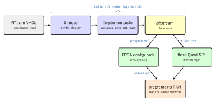

# Síntese em FPGA

Este documento descreve o processo completo de implementação do SoC RISC-V em hardware FPGA, desde a síntese lógica do código VHDL até a transferência do bitstream e carregamento do firmware. O fluxo documentado utiliza a ferramenta Vivado da Xilinx e é orquestrado por scripts TCL automatizados, eliminando a necessidade de interação via interface gráfica.

---

## Fluxo de Síntese e Implementação

### Síntese Lógica

A **síntese lógica** é o processo de traduzir a descrição comportamental do hardware em linguagem VHDL (Register Transfer Level) para uma netlist de componentes genéricos disponíveis na FPGA-alvo. Este processo é realizado pelo comando `synth_design` no Vivado e transforma estruturas VHDL em primitivas físicas da arquitetura do dispositivo.

No contexto deste projeto, a síntese é invocada pelo script `build.tcl` com os seguintes parâmetros críticos:

```tcl
synth_design -top soc_top -part xc7a100tcsg324-1 \
    -generic "INIT_FILE=build/fpga/boot/bootloader.hex" \
    -flatten_hierarchy rebuilt -retiming -quiet
```

Esses parâmetros são fundamentais para o projeto: o `-part` define o dispositivo-alvo da família Artix-7, enquanto `-generic "INIT_FILE=..."` automatiza a injeção do conteúdo do bootloader no arquivo HEX para a memória ROM (inicialização de BRAM), garantindo que o código de boot esteja presente no bitstream gerado sem necessidade de intervenção manual.

#### Tradução RTL para Netlist

O processo de síntese executa as seguintes transformações:

1. **Análise semântica**: O sintetizador verifica a descrição VHDL, realizando inferência de circuitos combinacionais e sequenciais a partir de expressões booleanas e estruturas `process`.

2. **Mapeamento em primitivas**: Os módulos VHDL são mapeados nas primitivas disponíveis na FPGA Xilinx Artix-7:
    * **LUTs (Look-Up Tables)**: Funções booleanas de até 6 entradas que implementam lógica combinacional
    * **Flip-Flops (FFs)**: Elementos de armazenamento para lógica sequencial (registradores)
    * **MUXEs**: Seletores implementados via LUTs ou recursos dedicados
    * **Carry Chains**: Caminhos de propagação rápida para operações aritméticas

3. **Inferência de memórias**: O sintetizador reconhece padrões de descrição de memórias (arrays, sinais com índice) e os mapeia em dois tipos distintos de recursos. A **LUTRAM** (RAM distribuída) utiliza as LUTs da malha lógica comum da FPGA, sendo adequada para estruturas pequenas como FIFOs curtas ou registradores de deslocamento com memória. Já a **BRAM** (Block RAM) consiste em blocos de silício dedicados com alta densidade, sendo a escolha ideal para a memória principal, bootloader ou qualquer estrutura que exija grande capacidade de armazenamento.

4. **Generic Injection**: O parâmetro `-generic "INIT_FILE=..."` permite injetar o conteúdo do bootloader em memória ROM (inicialização de BRAM com o arquivo `.hex`), possibilitando que o código de boot esteja presente no bitstream gerado.

#### Flags de Otimização

Conhecer estas flags é útil caso seja necessário ajustar a área consumida ou resolver problemas de temporização (timing) no futuro.

| Flag | Função |
|------|--------|
| `-flatten_hierarchy rebuilt` | Elimina a hierarquia de módulos, permitindo otimizações cross-boundary entre entidades VHDL |
| `-retiming` | Permite o deslocamento de registradores através de lógica combinacional para balancear caminhos críticos |
| `-quiet` | Suprime logs detalhados, reduzindo ruído na saída |

O resultado da síntese é uma netlist EDIF que representa a funcionalidade do design em termos de recursos genéricos da FPGA, sem considerar ainda a topologia física do dispositivo.

### Implementação (Place and Route)

A fase de **Implementação** transforma a netlist genérica em um desenho físico concreto, alocando cada primitiva a uma localização específica no silício da FPGA e criando as conexões físicas entre elas. Esta fase é composta por três etapas sequenciais invocadas no `build.tcl`:

```tcl
opt_design -quiet
place_design -quiet
route_design -quiet
```

#### Otimização Pré-Place (opt_design)

O comando `opt_design` executa otimizações lógicas sobre a netlist sintetizada:

* **Colapso de redundância**: Remove lógica combinacional duplicada
* **Ressíntese**: Reformula expressões booleanas para reduzir o número de LUTs
* **Extração de FSM**: Identifica máquinas de estados e as implementa com otimização de codificação (binary, one-hot, gray)
* **Otimização de carry**: Agrupa operações aritméticas em cadeias de carry dedicadas

#### Posicionamento (place_design)

O algoritmo de **Place** aloca cada célula lógica (LUT, FF, BRAM, DSP) a uma localização física específica nas fatias (SLICEs) da FPGA. Este posicionamento deve satisfazer:

1. **Restrições de localização**: Pinos de entrada/saída (IOBs) devem ser mapeados nos pinos metálicos definidos no arquivo de constraints

2. **Restrições de agrupamento**: Blocos relacionados (como uma FSM e suas saídas) devem ser posicionados próximos para minimizar o comprimento das conexões

3. **Otimização de timing**: O algoritmo tenta posicionar células em caminhos críticos mais próximas para reduzir atraso de roteamento

A FPGA Xilinx Artix-7 xc7a100t possui 15.850 slices, cada um contendo 4 LUTs de 6 entradas e 8 flip-flops. O posicionamento é armazenado em um checkpoint (DCP - Design Checkpoint) para permitir iterações.

#### Roteamento (route_design)

O **Route** cria as conexões físicas entre as células posicionadas utilizando os switches de programação (configurable switch boxes) disponíveis nas matrizes de roteamento da FPGA:

1. **Roteamento global**: Conexões de clock e sinais de alta fan-out usam recursos dedicados (global buffers)

2. **Roteamento local**: Sinais comuns utilizam a matriz de roteamento general-purpose, composta por linhas e colunas de metal comutáveis

3. **Análise de timing**: Durante o roteamento, o Vivado calcula o atraso de cada conexão (delay) baseado no modelo de atraso RC das linhas de metal

O atraso total de um caminho (path delay) é a soma dos atrasos das células atravessadas mais os atrasos de roteamento. A ferramenta verifica se este atraso satisfaz as restrições temporais definidas no XDC.

#### Relatórios de Saída

Após a implementação, o script gera os seguintes relatórios:

| Relatório | Conteúdo |
|-----------|----------|
| `utilization_route.rpt` | Utilização de cada tipo de recurso (LUT, FF, BRAM, DSP, IO) |
| `timing_summary.rpt` | Verificação de setup/hold para todos os caminhos; slack de cada domínio de clock |
| `power.rpt` | Estimativa de consumo de energia estático e dinâmico |

### Automação via script TCL

O `fpga/scripts/build.tcl` implementa o fluxo completo, sem a interface gráfica do Vivado, em seis etapas:

1. **Configuração:** o `board.tcl` escolhe, a partir de `BOARD`, o dispositivo (`xc7a100tcsg324-1` nas duas placas), a memória flash e os arquivos de restrições (`common.xdc` e o XDC da placa); as saídas vão para `build/fpga/<placa>/`.
2. **Leitura das fontes:** os pacotes e o RTL do núcleo multiciclo, o RTL do SoC e dos periféricos e o da NPU, em VHDL-2008.
3. **Síntese:** `synth_design` com o bootloader injetado na Boot ROM pelo *generic* `INIT_FILE`.
4. **Implementação:** `opt_design`, `place_design`, `phys_opt_design` e `route_design`; se ainda houver violação de *setup*, uma segunda passada de `phys_opt_design` após o roteamento. Os relatórios de utilização, temporização e potência ficam em `reports/`.
5. ***Bitstream* e flash:** `write_bitstream` gera o `.bit` (volátil, carregado pelo JTAG) e `write_cfgmem` gera o `.mcs` para a flash Quad-SPI, com o *bitstream* comprimido para um *boot* mais rápido.
6. **Resumo:** utilização de recursos e folga de temporização.

```bash
make fpga-build BOARD=nexys_a7   # equivale a: vivado -mode batch -source fpga/scripts/build.tcl -tclargs nexys_a7
```

O `program.tcl` carrega o `.bit` pelo JTAG (`make fpga-prog`), e o `flash.tcl` grava o `.mcs` na flash (`make fpga-flash`), para que a placa inicie com o SoC sempre que for ligada.

---

## Restrições Físicas e Temporais (Constraints)

### Ancoragem Física (nexys4.xdc / nexys_a7.xdc)

Os arquivos de pinagem `nexys4.xdc` e `nexys_a7.xdc` (Xilinx Design Constraints) faz a ligação entre a lógica descrita em VHDL e o mundo físico dos pinos metálicos do encapsulamento da FPGA. Cada declaração no XDC especifica o mapeamento de uma porta lógica (definida na entidade VHDL `soc_top`) a um pino específico do dispositivo.

#### Mapeamento Porta → Pino

A diretiva `PACKAGE_PIN` atribui uma porta lógica a um pino físico do encapsulamento:

```xdc
set_property -dict { PACKAGE_PIN E3 IOSTANDARD LVCMOS33 } [get_ports { CLK_i }];
```

Esta declaração significa:

* Porta `CLK_i` (sinal de clock de entrada) mapeada ao pino E3 do encapsulamento CSG324
* Pino E3 corresponde ao oscilador de 100 MHz da placa (Nexys A7 e Nexys 4)

A justificativa para este mapeamento específico reside no hardware da placa de desenvolvimento, onde o cristal oscilador está conectado fisicamente a este pino.

#### Padrão de Tensão IOSTANDARD

A diretiva `IOSTANDARD LVCMOS33` define o padrão de tensão para os pinos de entrada/saída:

* **LVCMOS33**: Low-Voltage CMOS com tensão de 3.3V
* Este padrão é definido porque:
    1. A placa utiliza tensão de 3,3 V nos bancos de I/O
    2. Os transceptores USB-UART (FTDI) operam em 3.3V
    3. LEDs e chaves pull-up/pull-down da placa são compatíveis com 3.3V

Utilizar um padrão incompatível resultaria em níveis lógicos incorretos, podendo danificar componentes ou causar falhas de comunicação.

#### Configuração de Energia Global

O arquivo também define parâmetros globais de configuração:

```xdc
set_property CFGBVS VCCO [current_design]
set_property CONFIG_VOLTAGE 3.3 [current_design]
```

Estas propriedades configuram o banco de tensão de configuração (Configuration Bank Voltage), determinando que os pinos de configuração operem a 3.3V. A escolha de CFGBVS=VCCO indica que a tensão de configuração segue a tensão VCCO dos bancos de I/O, neste caso 3.3V.

### Restrições de Clock

A definição do clock no XDC é fundamental para a Análise Estática de Temporização (STA - Static Timing Analysis):

```xdc
create_clock -add -name sys_clk_pin -period 10.00 -waveform {0 5} [get_ports { CLK_i }];
```

#### Propósito da Declaração de Clock

A diretiva `create_clock` comunica ao Vivado que o pino `CLK_i` é um sinal periódico com período de 10.0 nanossegundos (frequência de 100MHz). Com esta informação, a ferramenta pode:

1. **Calcular atrasos de caminho**: Cada caminho entre registradores tem um atraso máximo permitido definido pelo período do clock

2. **Verificar setup (tempo de preparação)**: Para um flip-flop capturar corretamente um dado na próxima borda de clock, o dado deve ser estável por pelo menos `T_su` (setup time) antes da borda. O Vivado verifica se `T_arrival + T_su <= T_period`

3. **Verificar hold (tempo de manutenção)**: O dado deve permanecer estável por pelo menos `T_h` (hold time) após a borda de clock para garantir captura correta. O Vivado verifica se `T_arrival >= T_h`

4. **Determinar domínios de clock**: Sinais assíncronos com clocks diferentes são tratados como domínios de clock separados, e o projetista deve inserir lógica de sincronização (async fifo, two-stage synchronizer) para transferência entre domínios

#### Relação Física

Fisicamente, o clock de 100MHz alimenta os flip-flops do design através da rede de clock da FPGA (global buffers BUFG). Sem a declaração `create_clock`, o Vivado não conseguiria determinar as janelas de tempo válidas para amostragem de dados, e a análise de temporização seria incompleta ou incorreta.

A violação de setup resulta em metastabilidade, onde o flip-flop pode oscilar entre estados válidos por um tempo indefinido antes de estabilizar, corrompendo o dado registrado.

---

## Programação e Upload na FPGA

### Configuração de Hardware via JTAG

O protocolo **JTAG** (Joint Test Action Group) é a interface de comunicação que permite ao Vivado transferir o bitstream gerado do computador para a memória de configuração da FPGA. Nas placas Nexys A7 e Nexys 4, essa comunicação ocorre pelo mesmo cabo USB da alimentação e da UART, por meio do conversor USB-JTAG da placa.

O script `program.tcl` executa esta operação:

```tcl
open_hw_manager
connect_hw_server
open_hw_target

set device [lindex [get_hw_devices] 0]
current_hw_device $device
set_property PROGRAM.FILE ./build/fpga/$boardName/bitstream/soc_top.bit $device
program_hw_devices $device
```

#### Processo de Programação

1. **Conexão**: O Vivado abre o Hardware Manager e conecta ao servidor de hardware local (ou remoto via cable server)

2. **Descoberta**: O comando `open_hw_target` varre a cadeia JTAG e identifica os dispositivos conectados

3. **Seleção**: O dispositivo FPGA (xc7a100t) é selecionado como alvo

4. **Transferência**: O arquivo `.bit` (contendo a configuração dos CLBs, BRAMs, IOBs, e rotas) é transferido via JTAG para a memória de configuração da FPGA

5. **Inicialização**: A FPGA inicia a execução imediata após a configuração, com o código do bootloader sendo executado a partir da BRAM carregada com o conteúdo de `bootloader.hex`

### Carga de Software via UART

Após a FPGA estar configurada, o firmware da aplicação usuário deve ser transferido para a RAM do SoC. O script `upload.py` automatiza este processo utilizando a UART do sistema.

#### Arquitetura do Protocolo de Upload

O protocolo implementado segue uma sequência de handshake:

1. **Reset de Hardware**: O script usa o pino RTS da UART para falar com o controlador de depuração, que reseta o SoC com o boot na ROM:
   ```python
   ser.rts = False                      # UART com o controlador de depuração
   ser.write(b'\xCA\xFE\xBA\xBE')      # Magic word do depurador
   ser.write(b'\x09\x00\x00\x00\x00')  # Endereço de boot = 0x00000000 (ROM)
   ser.write(b'\x08')                   # Reset com a CPU parada
   ser.rts = True                       # Devolve a UART ao SoC e solta a CPU
   ```

2. **Aguarda Bootloader**: O SoC, ao inicializar, transmite a string "[BOOT]" via UART indicando que está pronto para receber firmware

3. **Handshake**:
    * Host envia Magic Word `0xCAFEBABE` em até ~1 s depois do `[BOOT]` (o host envia em ~0,1 s); sem ela, o bootloader tenta carregar o programa gravado no cartão microSD
    * Bootloader confirma com `!`

4. **Transmissão do Tamanho**:
    * Host envia tamanho do binário (4 bytes, little-endian)
    * Formato: `struct.pack('<I', file_size)`
    * O bit 31 ligado (`--save`) pede ao bootloader que grave o programa também no cartão microSD; tamanho 0 com o bit 31 (`--erase-sd`) apaga o programa do cartão

5. **Transferência do Binário**:
    * Dados enviados em blocos de 64 bytes
    * ACK visual: bootloader envia `.` a cada 1KB recebido

6. **Confirmação**: Bootloader envia `>` ao final da transmissão bem-sucedida. Com `--save`, as mensagens do cartão (`SD: gravado`, `SD: sem cartao`...) vêm antes do `>`, e o `upload.py` as mostra

7. **Salto para Aplicação**: O bootloader transfere execução para o endereço `0x80000800` onde a aplicação foi gravada

#### Detalhes de Implementação

| Aspecto | Valor |
|---------|-------|
| Porta | `COM=/dev/ttyUSB1` no `make upload` (o `upload.py` usa `COM6` se chamado sem `-p`) |
| Baud rate | 921600 |
| Tamanho do bloco | 64 bytes |
| Endereço de carregamento | 0x80000800 |
| Timeout | 2 segundos |

O uso de baud rate alto (921600) reduz o tempo de transferência, e a transferência fragmentada permite feedback visual progressivo durante o upload.

---

## Resumo do Pipeline Completo

O fluxo de implementação pode ser sintetizado na seguinte sequência:

<figure class="ax-figura" markdown>
  { width="640" }
  <figcaption>Fluxo de implementação: o <code>build.tcl</code> sintetiza, implementa e gera o <em>bitstream</em> e a imagem da flash; o <code>program.tcl</code> configura a FPGA pelo JTAG e o <code>flash.tcl</code> grava a flash; por fim, o programa chega à RAM pela UART ou pelo cartão.</figcaption>
</figure>

Este pipeline automatizado permite iterações rápidas durante o desenvolvimento, onde cada modificação no código VHDL pode ser sintetizada, programada e testada sem intervenção manual na ferramenta de desenvolvimento.