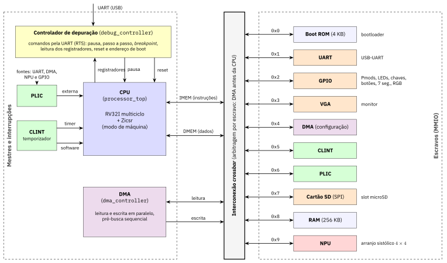

# SoC RISC-V

Este repositório contém um **sistema-em-chip (SoC) RISC-V didático**, escrito em **VHDL-2008** e validado em FPGA (Digilent Nexys A7-100T, Xilinx Artix-7, 100 MHz). O núcleo implementa a ISA `RV32I_Zicsr` em uma microarquitetura multiciclo, ligada por uma interconexão *crossbar* a memórias, controladores de interrupção, DMA, periféricos de entrada e saída e a uma [Unidade de Processamento Neural (NPU)](perifericos/npu.md) própria.

<figure class="ax-figura" markdown>
  { width="720" }
  <figcaption>Diagrama de blocos do SoC (<code>soc_top.vhd</code>): mestres (CPU e DMA) e escravos mapeados em memória, ligados por uma interconexão <em>crossbar</em>.</figcaption>
</figure>

## Motivação

O ensino de Arquitetura de Computadores costuma se apoiar em processadores escalares clássicos, enquanto os sistemas atuais são heterogêneos e combinam núcleos de uso geral com aceleradores de domínio específico. Simuladores didáticos abstraem o hardware, e projetos sintetizáveis de código aberto raramente são pensados para o ensino; nenhum dos ecossistemas didáticos analisados explora a aceleração neural.

Este projeto propõe uma plataforma que expõe, em hardware real, as decisões de projeto de um SoC completo: do caminho de dados do processador ao barramento, à hierarquia entre mestres e escravos, às interrupções e à integração de um acelerador. Todos os blocos são escritos para serem lidos e modificados, com testes automatizados e uma documentação que acompanha o código.

## A ISA RISC-V

A **arquitetura do conjunto de instruções** (ISA) define a interface entre o software e o hardware. O RISC-V é uma ISA aberta, livre de *royalties* e modular: um conjunto base obrigatório de instruções inteiras (como o RV32I) pode ser estendido por extensões padronizadas, como multiplicação (M) e ponto flutuante (F), ou por extensões próprias. Como toda arquitetura RISC, segue o modelo ***load/store***: só as instruções de carga e armazenamento acessam a memória, e as operações lógicas e aritméticas ocorrem entre registradores.

!!! note "RV32I_Zicsr"
    O `RV32I` é o conjunto base de instruções inteiras de 32 bits. A extensão `Zicsr` acrescenta as instruções que leem e escrevem os registradores de controle e estado (CSRs), necessárias para tratar [exceções e interrupções](processador/interrupcoes.md).

A **microarquitetura** é a forma como a ISA é implementada em hardware, e cada escolha é um compromisso. O tempo de execução de um programa é

$$
T_{\text{execução}}=N_{\text{instruções}}\times \mathrm{CPI}\times T_{\text{ciclo}},
$$

em que $N_{\text{instruções}}$ depende do programa e da ISA, o CPI (ciclos por instrução) da microarquitetura e $T_{\text{ciclo}}$ do caminho crítico. Uma organização [monociclo](processador/monociclo.md) tem CPI igual a 1, mas o período do relógio precisa acomodar a instrução mais lenta; a organização [multiciclo](processador/multiciclo.md), usada no SoC, divide cada instrução em estágios, reaproveita as unidades funcionais e permite um relógio mais rápido.

## Recursos

| Bloco | Descrição |
|---|---|
| Núcleo | RV32I_Zicsr multiciclo, modo de máquina, com exceções e interrupções (CLINT e PLIC) |
| Interconexão | *Crossbar* com arbitragem por escravo: mestres que acessam escravos diferentes são atendidos no mesmo ciclo |
| Memórias | Boot ROM de 4 KB (bootloader) e RAM de 256 KB de porta dupla |
| DMA | Controlador de acesso direto à memória, mestre do barramento ao lado da CPU |
| Periféricos | GPIO (LEDs, chaves, botões, *displays* de 7 segmentos, LEDs RGB e Pmods), UART pelo USB e UART2 no Pmod JA, VGA 320×240 e cartão microSD |
| NPU | Arranjo sistólico 4×4 INT8 para inferência de redes neurais ([documentação própria](https://risc-v-azedinha.github.io/NPU/)) |
| Depuração | Controlador pela UART: pausa, passo a passo, *breakpoint* em hardware e leitura dos registradores |

### Mapa de memória

| Região | Endereço base | Tamanho |
|---|---|---|
| Boot ROM | `0x0000_0000` | 4 KB |
| UART | `0x1000_0000` | 64 KB |
| GPIO | `0x2000_0000` | 64 KB |
| VGA | `0x3000_0000` | 128 KB |
| DMA | `0x4000_0000` | 64 KB |
| CLINT | `0x5000_0000` | 64 KB |
| PLIC | `0x6000_0000` | 256 KB |
| Cartão SD | `0x7000_0000` | 16 B |
| RAM | `0x8000_0000` | 256 KB |
| NPU | `0x9000_0000` | 256 MB |
| UART2 | `0xA000_0000` | 16 B |

A decodificação e os registradores de cada região estão em [Memória e DMA](soc/memoria-dma.md).

## Organização desta documentação

1. **[Primeiros passos](primeiros-passos.md):** ferramentas, simulação, compilação e execução na placa.
2. **Processador:** as microarquiteturas [monociclo](processador/monociclo.md) e [multiciclo](processador/multiciclo.md) e o tratamento de [exceções e interrupções](processador/interrupcoes.md).
3. **SoC:** a [interconexão](soc/interconexao.md), a [memória e o DMA](soc/memoria-dma.md) e o [controlador de depuração](soc/depuracao.md).
4. **Periféricos:** [GPIO](perifericos/gpio.md), [UART](perifericos/uart.md), [VGA](perifericos/vga.md), [cartão microSD](perifericos/sd.md) e [NPU](perifericos/npu.md).
5. **Software:** a [compilação e o build](software/build.md), o [boot](software/boot.md) e os [linker scripts](software/linker.md).
6. **Aplicações:** [programas e testes](aplicacoes/programas.md), os [servidores da NPU](aplicacoes/servidores-npu.md) e as [ferramentas do hospedeiro](aplicacoes/ferramentas.md).
7. **Desenvolvimento:** a [verificação](desenvolvimento/verificacao.md) e a [síntese em FPGA](desenvolvimento/sintese.md).

## Estrutura do repositório

```text
RISC-V/
├── rtl/
│   ├── core/          # Núcleos monociclo e multiciclo (cada um com o seu pkg/ da ISA)
│   ├── soc/           # soc_top, interconexão, Boot ROM, RAM, DMA, CLINT, PLIC e depuração
│   └── perips/        # GPIO, UART, VGA, cartão SD e NPU (submódulo)
├── sim/               # Testes Cocotb: unitários, de integração e end-to-end
├── fpga/
│   ├── constraints/   # XDC comum e das placas Nexys 4 e Nexys A7
│   ├── scripts/       # Síntese, programação e gravação da flash (Vivado em modo batch)
│   ├── sw/            # Bootloader, BSP/HAL, linker scripts, apps, testes e servidores
│   ├── upload.py      # Envio de programas pela UART (e gravação no cartão SD)
│   └── sd_image.py    # Gravação do cartão SD pelo computador
├── tools/             # Clientes da NPU, benchmarks e depurador
├── scripts/           # Seleção de testes e dependências (CI)
├── docs/              # Esta documentação (MkDocs)
└── makefile           # Testes, compilação, síntese e upload
```
