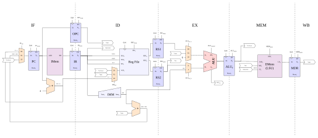
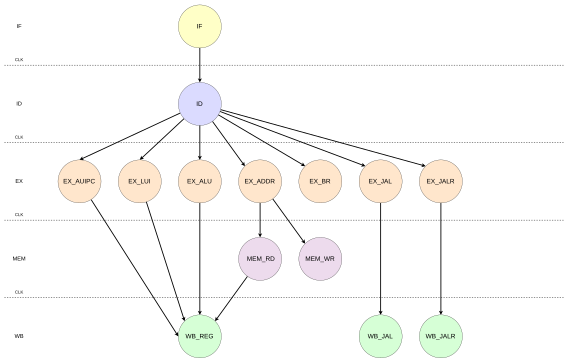
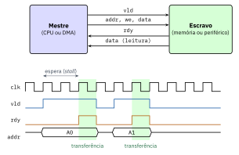

# Microarquitetura multiciclo

A microarquitetura multiciclo representa uma evolução significativa em relação ao modelo monociclo. Enquanto no monociclo cada instrução é completamente executada em um único pulso de relógio, o multiciclo divide a execução em múltiplos ciclos, permitindo frequencies de operação mais altas e melhor utilização dos recursos de hardware.

## A Transição: Single-Cycle para Multi-Cycle

### Motivação Física: O Problema do Clock

Na arquitetura monociclo, o período do clock é determinado pelo **caminho crítico** — o maior tempo de propagação combinacional ao longo do circuito. Este caminho crítico inclui obrigatoriamente:

1. Leitura da memória de instruções
2. Decodificação e leitura do banco de registradores
3. Execução na ALU
4. Acesso à memória de dados (para loads/stores)
5. Escrita no banco de registradores

Como todas essas etapas devem caber em um único ciclo, o clock deve ser lento o suficiente para acomodar o pior caso. Isso significa que instruções simples (como `ADD` entre registradores) são forçadas a esperar, pois a sua execução real é muito mais rápida que o tempo total disponível.

**A solução multiciclo:** Ao dividir a execução em etapas menores e balanceadas, cada estágio pode ser completado em um tempo muito menor. O somatório dos estágios resulta em um caminho crítico por estágio significativamente reduzido, permitindo que o processador opere em frequências substancialmente maiores.

### Latência de Memória

O modelo monociclo assume implicitamente que as memórias respondem em tempo zero — uma abstração útil para análise, mas irrealista para implementações práticas.

**O problema com memórias reais:**

- Memórias síncronas (block RAMs em FPGAs) tipicamente requerem 1 a 3 ciclos de latência
- Memórias externas (DDR, SRAM) podem exigir dezenas de ciclos
- O modelo monociclo não tolera essa variabilidade sem comprometer a frequência

**A solução multiciclo:**
A arquitetura multiciclo introduz estágios dedicados para acesso à memória. O processador pode "congelar" a FSM em estados de espera até que a memória retorne o sinal de `ready`, mantendo o determinismo da execução sem fixer a frequência do clock à latência máxima de memória.

---

## O Novo Caminho de Dados (Datapath Multiciclo)

A principal diferença visual entre o datapath monociclo e multiciclo é a presença de **registradores de estágio** (pipeline registers) que separam logicamente cada fase da execução:

<figure class="ax-figura" markdown>
  { width="100%" }
  <figcaption>Caminho de dados do núcleo multiciclo (<code>datapath.vhd</code>). Os registradores de estágio, em azul, guardam os resultados entre os ciclos de uma instrução: OPC (PC da instrução), IR, RS1, RS2, ALU<sub>r</sub> e MDR, cada um com a sua habilitação de escrita. As <em>tags</em> indicam sinais ligados entre pontos distantes do diagrama; a mesma ULA é reaproveitada nos vários estágios.</figcaption>
</figure>

### Registradores de estágio

No multiciclo, cada instrução ocupa vários ciclos, e o que um ciclo calcula precisa sobreviver até o ciclo seguinte. Para isso, o caminho de dados ganha **registradores de estágio**, cada um com a sua própria habilitação de escrita, comandada pela unidade de controle:

| Registrador | Guarda | Escrito em | Habilitação |
|---|---|---|---|
| `OPC` (*old PC*) | O endereço da instrução corrente, para os cálculos relativos ao PC (desvios, `jal`, `auipc`) | IF | `OPCWrite` |
| `IR` | A instrução lida da memória | IF | `IRWrite` |
| `RS1`, `RS2` | Os dois operandos lidos do banco de registradores | ID | `RS1Write`, `RS2Write` |
| `ALUr` | O resultado da ULA: valor aritmético, endereço de memória ou alvo do `jalr` | EX | `ALUrWrite` |
| `MDR` | O dado lido da memória de dados | MEM | `MDRWrite` |

A habilitação é o que dá ao controle o domínio do tempo: um registrador só muda no ciclo em que o seu sinal está ativo, e mantém o valor nos demais. É por isso que, por exemplo, o `IR` continua mostrando a instrução corrente enquanto o PC já aponta para a próxima.

### Reuso de hardware

A outra vantagem do multiciclo é a **reutilização temporal**: como as etapas de uma instrução acontecem em ciclos diferentes, um mesmo bloco pode servir a etapas diferentes. A ULA é o exemplo central; ela calcula:

- a operação aritmética ou lógica das instruções dos tipos R e I (em EX_ALU);
- o endereço de memória dos *loads* e *stores*, `rs1 + imediato` (em EX_ADDR);
- o alvo do `jalr`, também `rs1 + imediato` (em EX_JALR);
- o valor do `lui` (`0 + imediato`) e do `auipc` (`OPC + imediato`).

Os multiplexadores da entrada da ULA escolhem os operandos de cada caso: `ALUSrcA` escolhe entre `RS1` (`00`), `OPC` (`01`) e zero (`10`), e `ALUSrcB`, entre `RS2` (`0`) e o imediato (`1`). Dois cálculos continuam com somadores próprios, porque acontecem em paralelo com outros: `PC + 4`, feito durante a busca, e `OPC + imediato`, o alvo dos desvios e do `jal`, que precisa estar pronto enquanto a ULA compara os operandos do desvio.

---

## Unidade de Controle e Sincronização

### A Máquina de Estados Finita (FSM)

Na arquitetura multiciclo, a Unidade de Controle é implementada como uma **FSM de Moore** — uma máquina de estados finitos onde as saídas dependem exclusivamente do estado atual. O arquivo `main_fsm.vhd` implementa esta FSM, organizada em estados que correspondem às fases lógicas de execução:

<figure class="ax-figura" markdown>
  { width="100%" }
  <figcaption>Máquina de estados do núcleo multiciclo (<code>main_fsm.vhd</code>), organizada pelos estágios IF, ID, EX, MEM e WB. Cada instrução passa por IF e ID e segue o caminho do seu tipo. Além dos estados mostrados, IF, MEM_RD e MEM_WR esperam o <code>rdy</code> da memória; EX_FENCE e EX_SYSTEM (CSR, <code>ecall</code>, <code>mret</code>) partem de ID; e uma interrupção pendente em ID desvia a próxima busca para o tratador.</figcaption>
</figure>

#### Estados da FSM

A FSM é definida pelo tipo `t_state` em `main_fsm.vhd:127-134`:

```vhdl
type t_state is (
    S_IF,                                                                        -- IF  (Instruction Fetch)
    S_ID,                                                                        -- ID  (Instruction Decode)
    S_EX_ALU, S_EX_ADDR, S_EX_BR, S_EX_JAL, S_EX_JALR, S_EX_LUI, S_EX_AUIPC,   -- EX  (Execution)
    S_EX_FENCE, S_EX_SYSTEM,
    S_MEM_RD, S_MEM_WR,                                                          -- MEM (Memory Access)
    S_WB_REG, S_WB_JAL, S_WB_JALR                                                -- WB  (Write-Back)
);
```

**Fluxo de Estados:**

1. **S_IF (Instruction Fetch):** 
    - PC é enviado para memória de instruções
    - Instrução é armazenada no IR
    - PC é incrementado para PC+4

2. **S_ID (Instruction Decode):**
    - Instrução é decodificada
    - Registradores rs1 e rs2 são lidos para os registradores A e B
    - Imediato é gerado

3. **S_EX_\* (Execution):**
    - A ALU executa a operação conforme o tipo de instrução
    - Cada variante (ALU, ADDR, BR, JAL, etc.) configura a ALU de forma diferente

4. **S_MEM_RD / S_MEM_WR (Memory Access):**
    - Acesso à memória de dados para loads e stores

5. **S_WB_\* (Write-Back):**
    - Resultado é escrito no registrador de destino

Em uma **FSM do tipo Moore**, os sinais de saída dependem exclusivamente do **estado atual**, e não diretamente das entradas, o que torna o comportamento do controle mais estável e alinhado à divisão do processamento em ciclos bem definidos.

**Tabela Completa de Transição de Estado**

| Estado Atual | Condição   | Próximo Estado | Descrição do Estado                                    | 
| :----------: | :--------: | :------------: | :----------------------------------------------------: | 
| IF           | -          | ID             | Busca instrução e incrementa PC (PC+4)                 | 
| ID           | Tipo-R/I   | EX_ALU         | Decodifica instruções aritméticas/lógicas              | 
| ID           | Load/Store | EX_ADDR        | Decodifica acesso à memória                            | 
| ID           | Branch     | EX_BR          | Decodifica desvio condicional                          | 
| ID           | JAL        | EX_JAL         | Decodifica salto incondicional imediato                | 
| ID           | JALR       | EX_JALR        | Decodifica salto incondicional via registrador         | 
| ID           | LUI        | EX_LUI         | Decodifica carregamento imediato superior              | 
| ID           | AUIPC      | EX_AUIPC       | Decodifica adição de imediato ao PC                    | 
| ID           | FENCE      | EX_FENCE       | Sem efeito neste núcleo (memória sem *cache*)          | 
| ID           | SYSTEM     | EX_SYSTEM      | CSR, `ecall` ou `mret`                                 | 
| ID           | Interrupção pendente | IF   | Descarta a instrução; a busca seguinte vai para `mtvec` | 
| EX_ALU       | -          | WB_REG         | Operação da ALU concluída. Vai escrever no RegFile     | 
| EX_ADDR      | Load       | MEM_RD         | Endereço calculado. Vai ler da memória                 | 
| EX_ADDR      | Store      | MEM_WR         | Endereço calculado. Vai escrever na memória            | 
| EX_BR        | -          | IF             | Avalia condição (`Zero`) e atualiza PC se necessário   | 
| EX_JAL       | -          | WB_JAL         | Calcula alvo (`OldPC+IMM`) imediatamente               | 
| EX_JALR      | -          | WB_JALR        | Calcula alvo (`rs1+IMM`) e salva em ALUResult          | 
| EX_LUI       | -          | WB_REG         | Soma `0+IMM`. Vai para write-back                      | 
| EX_AUIPC     | -          | WB_REG         | Soma `PC+IMM`. Vai para write-back                     | 
| EX_FENCE     | -          | IF             | Segue para a próxima instrução                         | 
| EX_SYSTEM    | CSR válido | WB_REG         | Escreve o valor antigo do CSR em `rd`                  | 
| EX_SYSTEM    | `ecall`, `mret` ou CSR inválido | IF | Desvia para `mtvec` ou retorna para `mepc`   | 
| MEM_RD       | -          | WB_REG         | Lê `DMem[ALUResult]` e atualiza MDR                    | 
| MEM_WR       | -          | IF             | Escreve RS2 em `DMem[ALUResult]`                       | 
| WB_REG       | -          | IF             | Escrita do resultado em `rd`                           | 
| WB_JAL       | -          | IF             | Escreve retorno (`PC+4`) em `rd`. PC já foi atualizado | 
| WB_JALR      | -          | IF             | Escreve retorno (`PC+4`) em `rd`. PC é atualizado      | 

**Tabela Completa de Sinais de Controle**

| Sinal  | Descrição do Sinal de Controle|
| :-: | :-- |
| `PCWrite` | Habilita escrita no `PC`. Permite que o PC seja atualizado apenas em estados específicos (como Fetch ou ao realizar um salto - branch/jump) |
| `OPCWrite` | Atualiza o `OldPC`. Guarda o valor atual do PC no registrador `r_OldPC`. É usado para salvar o endereço da instrução corrente - usando-o para cálculos relativos - atualizado normalmente no estado de Fetch |
| `PCSrc` | Seletor da fonte do próximo `PC`. Controla o multiplexador que define o novo valor do PC. Oppções são: `00` (`PC + 4`); `01` (Branch/JAL); `10` (JALR) |
| `IRWrite` | Habilita a escrita no `IR`. Permite carregar uma nova instrução apenas durante o estado de Fetch. | 
| `MemWrite` | Habilita a escrita na memória. Sinal enviado para a unidade de armazenamento e carga (LSU) para efetuar a gravação de um dado. |
| `ALUSrcA` | Seletor do Operando A da ALU. Opções: `00` (rs1); `01` (PC atual); `10` (zero) |
| `ALUSrcB` | Seletor do Operando B da ALU. Opções: `0` (rs2); `1` (imediato) |
| `ALUControl` | Seletor para a operação da ALU. Define qual operação a ALU deve executar (ADD, SUB, AND etc.) |
| `RegWrite` | Habilita a escrita no banco de registradores. Permite gravar no registrador `rd` durante o estágio de write-back (WB) |
| `WBSel` | Seletor do dado de write-back. Opções: `00` (resultado da ALU); `01` (MDR); `10` (próximo PC); `11` (CSR) |
| `RS1Write` | Habilita a atualização do regisitrador de RS1. Controla a capatura do valor lido de `rs1` do banco de registradores |
| `RS2Write` | Habilita a atualização do regisitrador de RS2. Controla a capatura do valor lido de `rs2` do banco de registradores |
| `ALUrWrite` | Habilita a atualização do ALUResult. Controla a captura do resultado da ALU |
| `MDRWrite` | Habilita a escrita no MDR. Captura o dado carregado da memória | 

**Tabela Completa de Sinais por Estado**

**Legenda de Sinais**

* **ALUSrcA:** `00`=rs1; `01`=OldPC; `10`=Zero
* **ALUSrcB:** `0`=rs2; `1`=Imediato
* **PCSrc:** `00`=PC+4; `01`=Branch/JAL (Somador Dedicado); `10`=JALR (ALUResult)
* **WBSel:** `00`=ALUResult; `01`=MDR; `10`=PC+4 (Retorno); `11`=CSR
* **Cond:** Habilitado apenas se a condição de Branch for satisfeita (Zero flag)
* **ALUControl:** `ADD` (Força Soma); `Funct` (Tipo-R/I); `Branch` (Resolve SUB/SLT/SLTU via funct3)

| Estado  | `PCWrite` | `OPCWrite` | `PCSrc`       | `IRWrite` | `MemWrite` | `ALUSrcA`      | `ALUSrcB`      | `ALUControl` | `RegWrite` | `WBSel`        | `RS1Write` | `RS2Write` | `ALUrWrite` | `MDRWrite` |
| :--- | :---: | :---: | :---: | :---: | :---: | :---: | :---: | :---: | :---: | :---: | :---: | :---: | :---: | :---: |
| **IF** | 1 | 1 | 00 | 1 | 0 | X | X | X | 0 | X | 0 | 0 | 0 | 0 |
| **ID** | 0 | 0 | X | 0 | 0 | X | X | X | 0 | X | 1 | 1 | 0 | 0 |
| **EX_ALU** | 0 | 0 | X | 0 | 0 | 00 | **0/1** | **Funct** | 0 | X | 0 | 0 | 1 | 0 |
| **EX_ADDR**| 0 | 0 | X | 0 | 0 | 00 | 1 | **ADD** | 0 | X | 0 | 0 | 1 | 0 |
| **EX_BR** | **Cond** | 0 | 01 | 0 | 0 | 00 | 0 | **Branch** | 0 | X | 0 | 0 | 0 | 0 |
| **EX_JAL** | 0 | 0 | X | 0 | 0 | X | X | X | 0 | X | 0 | 0 | 0 | 0 |
| **EX_JALR**| 0 | 0 | X | 0 | 0 | 00 | 1 | **ADD** | 0 | X | 0 | 0 | 1 | 0 |
| **EX_LUI** | 0 | 0 | X | 0 | 0 | 10 | 1 | **ADD** | 0 | X | 0 | 0 | 1 | 0 |
| **EX_AUIPC**| 0 | 0 | X | 0 | 0 | 01 | 1 | **ADD** | 0 | X | 0 | 0 | 1 | 0 |
| **MEM_RD** | 0 | 0 | X | 0 | 0 | X | X | X | 0 | X | 0 | 0 | 0 | 1 |
| **MEM_WR** | 0 | 0 | X | 0 | 1 | X | X | X | 0 | X | 0 | 0 | 0 | 0 |
| **WB_REG** | 0 | 0 | X | 0 | 0 | X | X | X | 1 | **00/01** | 0 | 0 | 0 | 0 |
| **WB_JAL** | 1 | 0 | 01 | 0 | 0 | X | X | X | 1 | 10 | 0 | 0 | 0 | 0 |
| **WB_JALR**| 1 | 0 | 10 | 0 | 0 | X | X | X | 1 | 10 | 0 | 0 | 0 | 0 |

### Protocolo de Sincronização (Handshake Ready/Valid)

Para tolerar memórias com latência variável, o processador implementa um protocolo de handshake `ready`/`valid` nas interfaces de memória.

!!! note "Hierarquia de Memória"
    O contraste entre BRAM e Memória Distribuída é definido pela latência: a BRAM economiza lógica mas "atrasa" o dado em 1-2 ciclos, enquanto a distribuída (registradores) é instantânea, mas cara em área. O protocolo Ready/Valid amarra essa hierarquia, servindo como o controle de tráfego que impede que a latência de acesso da memória cause perda de dados ou quebre o fluxo do pipeline (throughput) em altas frequências.

#### Interface de handshake

O núcleo tem duas interfaces de memória, uma para instruções (`IMem_*`) e outra para dados (`DMem_*`), e cada uma segue o mesmo protocolo: o núcleo ergue `vld` quando quer um acesso e espera o `rdy` da memória ou do periférico.

<figure class="ax-figura" markdown>
  { width="620" }
  <figcaption><em>Handshake</em> <code>vld</code>/<code>rdy</code> do barramento. O mestre ergue <code>vld</code> e mantém endereço e dados estáveis até o escravo responder com <code>rdy</code>; a transferência acontece no ciclo em que os dois estão em 1, e o mestre fica parado (<em>stall</em>) enquanto espera.</figcaption>
</figure>

#### Espera na máquina de estados

Os três estados que acessam a memória (IF, MEM_RD e MEM_WR) mantêm `vld` ativo e **não avançam** enquanto `rdy` não chega; os registradores que recebem o dado (`IR` e `MDR`) e o PC só são escritos no ciclo em que `rdy` vale 1. Com isso, o mesmo núcleo funciona com qualquer latência: uma BRAM que responde no ciclo seguinte, um periférico lento ou uma disputa no *crossbar* apenas acrescentam ciclos de espera. Em VHDL, a regra é uma transição condicional; por exemplo, na leitura de dados:

```vhdl
when S_MEM_RD =>
    if dmem_rdy_i = '1' then
        next_state <= S_WB_REG;   -- dado chegou: segue para o write-back
    else
        next_state <= S_MEM_RD;   -- espera (stall)
    end if;
```

---

## Integração no Top-Level

O `processor_top.vhd` do multiciclo apresenta a mesma estrutura de integração que o monociclo, porém com a diferença fundamental de que o Control Path agora é uma FSM em vez de lógica puramente combinacional.

A arquitetura de Harvard Modificada é mantida, com barramentos separados para IMEM e DMEM, permitindo acesso simultâneo a instruções e dados.

### Diferenças Principais entre Single-Cycle e Multi-Cycle

| Aspecto | Single-Cycle | Multi-Cycle |
|---------|--------------|-------------|
| **Ciclos por instrução** | 1 | 3 a 5, mais as esperas de memória |
| **Frequência máxima** | Limitada pelo caminho crítico completo | Maior (caminho crítico por estágio) |
| **Unidade de Controle** | Lógica combinacional | FSM sequencial |
| **Recursos de hardware** | Duplicados para paralelismo | Compartilhados no tempo |
| **Registradores intermediários** | Não existem | OPC, IR, RS1, RS2, ALUr, MDR |
| **Handshake de memória** | Não suportado nativamente | Suportado via Ready/Valid |
| **Complexidade de controle** | Baixa | Média-Alta |

---
