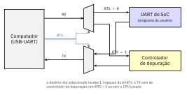
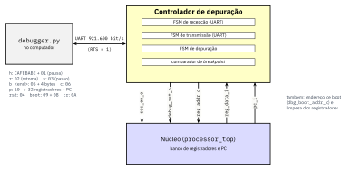

# Controlador de depuração

## Visão Geral

O **Debug Controller** é um módulo de hardware responsável por implementar uma interface de depuração out-of-band para o processador RISC-V. Este componente permite que umhost externo (PC) interaja com o SoC sem intrusão na execução normal do núcleo, possibilitando:

- **Pausa (halt)** e **retomada (resume)** da execução do processador
- **Execução passo a passo (step)** de instruções individuales
- **Leitura do estado interno** (banco de registradores e PC)
- **Hardware breakpoints** com detecção em latência zero
- **Reset controlada** do processador

A arquitetura implementa um modelo de **multiplexação física via RTS** (Request to Send), onde o sinal RTS da UART determina se a comunicação é roteada para o SoC (execução normal) ou para o Debug Controller (modo depuração).

---

## Interface de Comunicação e Protocolo

### Multiplexação Física UART (Y-Split)

O Debug Controller utiliza uma técnica de multiplexação física baseada no sinal RTS da UART para determinar o destino dos dados:

<figure class="ax-figura" markdown>
  { width="560" }
  <figcaption>Multiplexação da UART do USB pelo sinal RTS, em <code>soc_top.vhd</code>: com RTS = 0, o computador conversa com a UART do SoC; com RTS = 1, com o controlador de depuração.</figcaption>
</figure>

**Comportamento do RTS:**

- **RTS = 0 (ativo)**: O canal UART é roteado para o SoC. O Debug Controller ignora comandos recebidos.
- **RTS = 1 (repouso)**: O canal UART é roteado para o Debug Controller. O SoC fica "surdo" (recebe 1 lógico constante).

O TX segue a mesma regra, com uma exceção: enquanto a CPU está parada pelo depurador, a saída serial também vem do controlador de depuração, mesmo com RTS = 0, para que as respostas cheguem ao computador. Essa multiplexação fica no `soc_top.vhd`, fora do controlador, e custa apenas alguns multiplexadores nos pinos.

### Sequência de Handshake

Antes de qualquer operação de depuração, o host deve iniciar uma sequência de handshake para ativar o modo debug:

| Passo | Byte | Descrição |
|-------|------|-----------|
| 1 | `0xCA` | Magic byte inicial |
| 2 | `0xFE` | Confirmação protocolo |
| 3 | `0xBA` | Confirmação versão |
| 4 | `0xBE` | Ativação do modo debug |

A máquina de estados do controlador reconhece a sequência byte a byte: a cada byte esperado, avança um estado (`WAIT_FE`, `WAIT_BA`, `WAIT_BE`); qualquer byte diferente a devolve a `IDLE`. Assim, os dados comuns que o programa troca com o computador pela UART dificilmente ativam o depurador por acaso. Completada a sequência, o controlador pausa a CPU na próxima busca de instrução (ver [Pausa limpa](#estrategia-armed_wait_fetch)).

### Formato do Protocolo de Comandos

Após a ativação do modo debug, os seguintes comandos estão disponíveis:

| Opcode | Hexa | Função | Payload |
|--------|------|--------|---------|
| `CMD_HALT` | `0x01` | Pausa forçada da CPU | Nenhum |
| `CMD_RESUME` | `0x02` | Retoma execução | Nenhum |
| `CMD_STEP` | `0x03` | Executa 1 instrução | Nenhum |
| `CMD_RESET_RUN` | `0x04` | Reinicia o SoC e deixa a CPU executar | Nenhum |
| `CMD_SET_BKP` | `0x05` | Configura breakpoint | 4 bytes (endereço) |
| `CMD_CLR_BKP` | `0x06` | Remove breakpoint | Nenhum |
| `CMD_RESET_HALT` | `0x08` | Reinicia o SoC com a CPU parada | Nenhum |
| `CMD_SET_BOOT` | `0x09` | Define o endereço de boot do próximo reinício (`0x0000_0000`, a ROM, volta ao bootloader) | 4 bytes (endereço) |
| `CMD_CLR_REGS` | `0x0A` | Zera o banco de registradores | Nenhum |
| `CMD_READ_REG` | `0x10` | Dump de registradores | Nenhum |

### Máquina de Estados RX (Recepção Serial)

O controlador tem a sua própria UART, com a mesma estrutura da [UART do SoC](../perifericos/uart.md): o receptor espera o bit de início, aguarda meio período de bit para se alinhar ao centro dele, coleta os 8 bits de dado (do menos ao mais significativo) e confere o bit de parada.

---

## Controle de Execução (Halt, Resume e Step)

### Mecanismo de Pausa Não-Invasiva

O controlador pausa o processador pelo sinal `soc_en_o`, ligado à entrada `soc_en_i` do núcleo. Com `soc_en_i = 1`, a máquina de estados do núcleo avança normalmente; com `soc_en_i = 0`, ela simplesmente **não troca de estado**, e todos os registradores mantêm o valor. A pausa não altera nada no processador: ao liberar o sinal, a execução continua exatamente de onde parou.

### Estratégia ARMED_WAIT_FETCH

Parar o núcleo no meio de uma instrução deixaria o estado difícil de interpretar (um *store* pela metade, um `IR` já trocado). Por isso, depois de um comando de pausa, o controlador entra no estado `ARMED_WAIT_FETCH` e só baixa `soc_en_o` quando o núcleo sinaliza, por `is_fetch_stage_i`, que está na busca de uma nova instrução. A instrução em andamento termina, e a CPU para entre duas instruções, com o PC apontando para a próxima.

### Execução Passo a Passo (Step)

O passo a passo usa o mesmo sinal: o controlador libera a CPU (`soc_en_o = 1`), espera o núcleo **sair** da busca (estado `STEP_EXEC`) e, em seguida, espera que ele **volte** a uma busca (`STEP_FETCH`), quando pausa de novo. Entre as duas buscas, o núcleo executou exatamente uma instrução, qualquer que seja o número de ciclos que ela leve.

### Hardware Breakpoint com Latência Zero

O Debug Controller implementa um hardware breakpoint que detecta o endereço do PC de forma combinacional (mesmo ciclo de clock):

**Detecção combinacional.** O comparador olha o PC na busca de instrução e, no mesmo ciclo em que ele coincide com o endereço programado, derruba o `soc_en_o`, sem esperar a máquina de estados:

```vhdl
-- Detecta o endereço combinacionalmente no mesmo ciclo de clock
s_bkp_match <= '1' when (r_bkp_en = '1' and pc_i = r_bkp_addr 
              and is_fetch_stage_i = '1' and r_bkp_bypass = '0') else '0';

-- A CPU é congelada IMEDIATAMENTE (Latência Zero) se houver hit
soc_en_o <= '0' when (r_bkp_hit = '1' or s_bkp_match = '1') else r_soc_en;
```

**Saída do *breakpoint*.** Se nada mais fosse feito, ao retomar a execução o PC ainda estaria no endereço do *breakpoint*, e a CPU pararia de novo no mesmo lugar. Por isso, ao receber `RESUME`, `STEP`, reinício ou `CLR_BKP`, o controlador limpa a parada e ergue um *bypass*, que mantém o comparador desligado até o PC sair daquele endereço.

---

## Injeção e Inspeção de Estado

### Acesso ao Banco de Registradores

O banco de registradores tem uma **porta de leitura extra**, usada só pelo depurador: o controlador apresenta um endereço em `reg_addr_o` e recebe o valor em `reg_data_i`, sem interferir nas duas portas de leitura do caminho de dados. O PC é tratado como um 33º registrador (índice 32), escolhido por um multiplexador dentro do controlador.

### Fluxo de dump de registradores

O comando `READ_REG` (`0x10`) percorre os índices de 0 a 32 e transmite cada valor em 4 bytes, do menos para o mais significativo (*little-endian*): são 33 × 4 = **132 bytes**, que o `debugger.py` remonta para mostrar os 32 registradores e o PC. Durante o envio, a CPU permanece parada.

### Acesso à Memória

O Debug Controller **NÃO** possui acesso direto à memória RAM através do barramento. A arquitetura atual limita a inspeção de memória às seguintes opções:

| Método | Descrição |
|--------|-----------|
| **Dump de registradores** | Leitura do banco de registradores via porta dedicada |
| **Hardware Breakpoint** | Configuração de break em endereço específico |
| **Execução passo a passo** | Inspeção visual progressiva via registradores |

O acesso à memória seria possível através de:

1. **Leitura pelo processador**: Inserção de instruções LOAD via registradores
2. **DMA assistido**: Utilização do controlador DMA para transferência de blocos de memória (funcionalidade não implementada na versão atual)

---

## Diagrama de Arquitetura

<figure class="ax-figura" markdown>
  { width="680" }
  <figcaption>Caminho da depuração: o <code>debugger.py</code> envia comandos pela UART; o controlador de depuração pausa a CPU (<code>soc_en_o</code>), reinicia o SoC, lê os registradores e o PC e compara o PC com o <em>breakpoint</em>.</figcaption>
</figure>

---

## Limitações e Trabalhos Futuros

### Limitações Atuais

| Limitação | Descrição |
|-----------|-----------|
| **Escrita de registradores** | Não há suporte para write-back de registradores via debug |
| **Acesso à memória** | Não há acesso direto à RAM via Debug Controller |
| **Watchpoints** | Não há suporte para break em modificações de memória |
| **Breakpoints múltiplos** | Apenas 1 hardware breakpoint suportado |
| **Granularidade do passo a passo** | Cada passo executa uma instrução inteira; não é possível parar entre os estágios do multiciclo |

### Possíveis Extensões

- Implementação de porta de escrita dedicada para registradores
- Integração com Bus Arbitrer para acesso à memória durante halt
- Suporte a breakpoints múltiplos via tabela de endereços
- Implementação de watchpoints (detecção de escrita em memória)
- Comunicação via protocolo JTAG (IEEE 1149.1)

---

## Referência de API (Software Host)

### Comandos do Debugger Python

Consulte `tools/debugger.py` para a implementação de referência:

```python
# Comandos disponíveis
halt()          # → 0xCAFEBABE + 0x01
resume()       # → 0x02 + RTS=1
step()         # → 0x03
reset()        # → 0x04
set_bkp(addr)  # → 0x05 + 4 bytes (endereço)
clr_bkp()      # → 0x06
get_regs()     # → 0x10 → aguarda 132 bytes
```

### Exemplo de Sessão

```
# Iniciar sessão
$ python tools/debugger.py

# Pausar CPU
(-DBG) > h
[+] CPU Interceptada (Modo DEBUG ATIVO)

# Ler registradores
(-DBG) > p
 BANCO DE REGISTRADORES (RV32I)
────────────────────────────────────────────────────────
 x00 (zero) : 0x00000000    │ x01 (ra)  : 0x00000000
 x02 (sp)   : 0x00000000    │ x03 (gp)  : 0x00000000
 ...
────────────────────────────────────────────────────────
 ► PC Atual       : 0x000000A0

# Configurar breakpoint
(-DBG) > b 0x800
[*] Hardware Breakpoint armado em 0x00000800

# Retomar execução
(-DBG) > r

# Quando breakpoint atinge, host recebe notificação 0xBB
```

---
