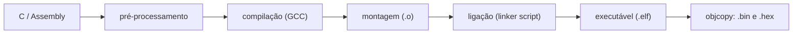

# Compilação e build

Os programas do SoC são escritos em C e Assembly e compilados no computador hospedeiro para o RV32I (**compilação cruzada**). O `makefile` da raiz orquestra a compilação, os testes, a síntese e o envio dos programas à placa.

## Compilação cruzada

O processador alvo não executa no computador de desenvolvimento, então o código é gerado por um compilador que roda em x86-64 e produz instruções RISC-V:

```bash
riscv64-unknown-elf-gcc       # compilador, montador e linker
riscv64-unknown-elf-objcopy   # conversão do executável em binário ou HEX
```

Apesar do "64" no nome, o mesmo *toolchain* gera código de 32 bits quando recebe as *flags* de arquitetura:

```bash
-march=rv32i_zicsr -mabi=ilp32 -nostdlib -nostartfiles --specs=picolibc.specs
```

- `-march=rv32i_zicsr`: só as instruções inteiras de 32 bits e as de CSR; o `makefile` detecta se o compilador instalado exige a extensão `_zicsr` explícita.
- `-mabi=ilp32`: inteiros, `long` e ponteiros de 32 bits, sem registradores de ponto flutuante.
- `-nostdlib -nostartfiles`: sem a biblioteca e o código de inicialização padrão; o SoC usa o próprio `start.s` e a sua HAL.
- `--specs=picolibc.specs`: os cabeçalhos da *picolibc*, uma libc pequena para sistemas embarcados.

!!! note "Sem multiplicação em hardware"
    Como o núcleo implementa só o RV32I, sem a extensão M, o GCC substitui cada multiplicação e divisão por uma chamada a rotinas de software (`__mulsi3`, `__divsi3`), que somam e deslocam bit a bit. Por isso uma MAC custa dezenas de ciclos na CPU, e o ganho da NPU é tão grande.

### Etapas



1. **Pré-processamento:** expande macros (`#define`) e inclui os cabeçalhos (`#include`).
2. **Compilação:** traduz o C para Assembly RISC-V, com as otimizações pedidas.
3. **Montagem:** converte o Assembly em código de máquina, em arquivos objeto (`.o`).
4. **Ligação:** combina os objetos, resolve os símbolos e posiciona cada seção (`.text`, `.rodata`, `.data`, `.bss`) no endereço definido pelo [linker script](linker.md).
5. **Conversão:** o `.elf` traz cabeçalhos, símbolos e informações de depuração; o `objcopy` extrai só os bytes do programa, em binário puro (`.bin`, enviado pela UART) ou em texto hexadecimal (`.hex`, usado para inicializar memórias na simulação e na síntese).

## O `makefile`

O `makefile` é um único arquivo na raiz do repositório, com quatro grupos de alvos.

### Programas da FPGA

| Alvo | O que faz |
|---|---|
| `make boot-fpga` | Compila o bootloader (`fpga/sw/platform/bootloader/boot.c`) com `boot.ld` e gera `build/fpga/boot/bootloader.hex`, embutido na Boot ROM durante a síntese |
| `make sw-fpga SW=<programa>` | Compila um programa de `fpga/sw/apps/`, `tests/` ou `server/` com `link.ld` e gera `build/fpga/bin/<programa>.{elf,bin,hex}` |
| `make upload SW=<programa>` | Compila e envia o programa pela UART com o `fpga/upload.py`; `SAVE=1` também o grava no cartão microSD |
| `make sd-erase` | Apaga o programa gravado no cartão |
| `make list-apps` | Lista os programas disponíveis |

Cada programa é ligado com o código de inicialização (`fpga/sw/platform/startup/start.s`) e com todos os arquivos da BSP (`fpga/sw/platform/bsp/`), que reúne o mapa de memória, a HAL de cada periférico e o despacho de interrupções. As otimizações diferem:

- **Bootloader:** `-Os` e remoção das funções não usadas (`--gc-sections`), porque a Boot ROM tem só 4 KB.
- **Programas:** `-O2`, com `-fno-tree-loop-distribute-patterns`, que impede o GCC de trocar laços por chamadas a `memset`/`memcpy`, inexistentes sem a libc.

### Simulação

| Alvo | O que faz |
|---|---|
| `make test-unit-<bloco>` | Simula um bloco isolado |
| `make test-int-<bloco>` | Simula vários blocos do núcleo juntos |
| `make test-e2e-<topo>` | Compila um programa e simula o processador ou o SoC executando-o |
| `make test-compliance` | Roda a suíte oficial de conformidade RV32I |
| `make list-tests` | Lista os testes |

O núcleo simulado é escolhido por `CORE_ARCH` (`multi_cycle`, o padrão, ou `single_cycle`). As regras montam a lista de fontes VHDL a partir dos pacotes da ISA do núcleo, do RTL do núcleo, dos periféricos, do SoC e da NPU, e chamam o *makefile* do Cocotb com o GHDL em VHDL-2008. A descrição dos testes está em [Verificação](../desenvolvimento/verificacao.md).

### Síntese

| Alvo | O que faz |
|---|---|
| `make fpga-build BOARD=<placa>` | Compila o bootloader e roda o `fpga/scripts/build.tcl`: síntese, implementação, *bitstream* e imagem da flash |
| `make fpga-prog BOARD=<placa>` | Programa a FPGA pelo JTAG (`program.tcl`) |
| `make fpga-flash BOARD=<placa>` | Grava a imagem na flash de configuração (`flash.tcl`) |

`BOARD` aceita `nexys4` (padrão) e `nexys_a7`. O Vivado roda em modo *batch*, sem interface gráfica, e os registros ficam em `build/fpga/<placa>/logs/`. O fluxo está detalhado em [Síntese em FPGA](../desenvolvimento/sintese.md).

### Variáveis

| Variável | Padrão | Uso |
|---|---|---|
| `CORE_ARCH` | `multi_cycle` | Núcleo simulado |
| `APP` | `hello` | Programa dos testes *end-to-end* do processador |
| `SW` | — | Programa compilado e enviado à FPGA |
| `COM` | `/dev/ttyUSB1` | Porta serial da placa |
| `SAVE` | — | `1` grava o programa no cartão microSD |
| `BOARD` | `nexys4` | Placa da síntese e da programação |
| `VIVADO_BIN`, `PYTHON_BIN` | `vivado`, `python3` | Executáveis usados |

`make clean` remove o diretório `build/` e os arquivos temporários da simulação.
